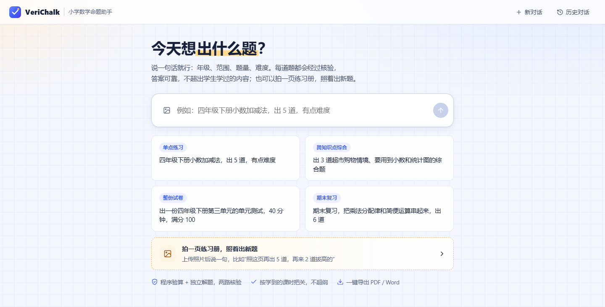
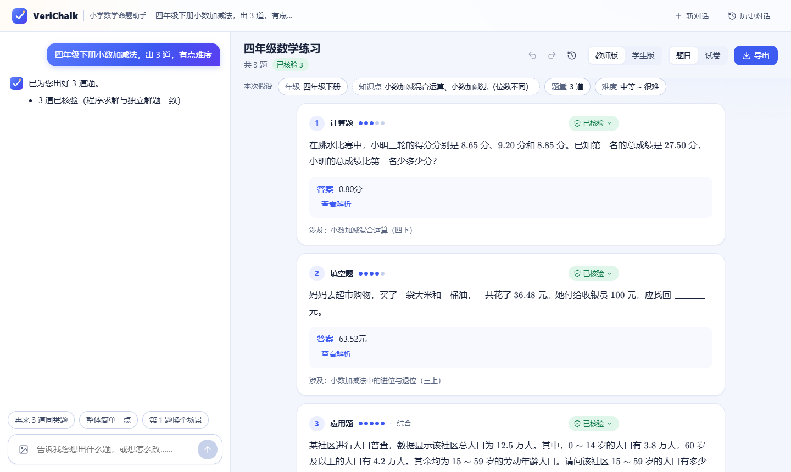
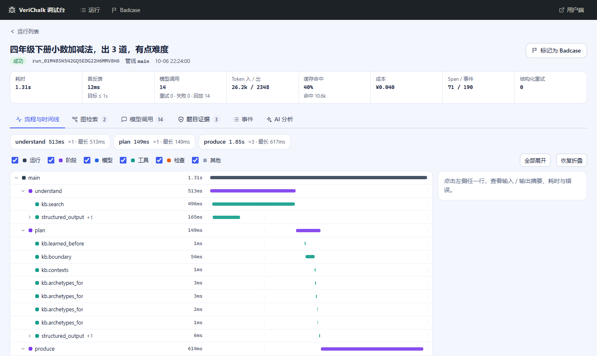

<div align="center">

# VeriChalk

**面向小学数学教师的可验证命题 Agent**

说一句话或拍一页练习册，得到答案经过核验、贴合学生进度的好题与整份试卷。

[](https://github.com/Scorpioyyy/verichalk/actions/workflows/ci.yml)


[功能](#功能) · [效果](#效果) · [工作原理](#工作原理) · [快速开始](#快速开始) · [文档](#文档)

</div>

https://github.com/user-attachments/assets/dfc727ef-641d-49c0-8d7e-8d446af08a58



## 为什么做 VeriChalk

"双减"之后，现成的练习题不够用，老师常要自己补题，也越来越多地借助大模型。但大模型出的题常常答案算错、超出学生所学，也很难把几个知识点串成一道综合题，老师仍得逐题检查修改（来自安徽霍邱师范附小数学老师的反馈）。

VeriChalk 让老师拿到就能用：**答案对**、**不超纲**，还能**把学过的知识点组合成有思维含量的综合题**。

## 核心优势

- ✅ **答案双重核验**：写题时同步写出求解程序精确计算，另一个模型独立盲解，两者一致才标"已核验"。
- 🎯 **不超纲**：按课时把握学生学过的数、运算和计量单位。
- 🧩 **综合题自然**：沿教材里知识点的前后联系设计解题链，前一步的结果就是后一步的条件。
- 🗣️ **听得懂老师**："只要计算题""课本那种基础题""情境用做蛋糕"，都照着出。
- 🖼️ **能出看图题**：统计图、数轴、钟面、标了尺寸的图形、方格图。

## 功能

| | |
|---|---|
| **一句话出题** | 如"四年级下册小数加减法，出 5 道，有点难度，跟买东西有关"；逐题上屏，需求含糊时只问一个问题 |
| **拍照出题** | 上传练习册、作业或试卷的照片，照着学生做过的题出新题 |
| **整份试卷** | 先定细目表，再看样题，最后成卷 |
| **在线修改** | 直接编辑，或一句话修改（"第 3 题换个场景"）；可撤销、可回看历史，改后自动复核 |
| **导出** | PDF、Word、Markdown、LaTeX；教师版 / 学生版 |
| **调试台** | 每次出题的流程、模型调用与核验证据一目了然 |



## 效果

与通用大模型直接出题对比（41 个出题请求、194 道题，覆盖 1～6 年级；答案与超纲由独立审计判定）：

| | **VeriChalk** | 通用大模型 |
|---|---|---|
| 答案正确 | **97.8%** | 84.1% |
| 超出学生所学 | **4.9%** | 13.8% |
| 可直接使用 | **80.9%** | 69.1% |
| 满足老师的具体要求 | **85.3%** | 62.4% |
| 两套题对比，更适合发给学生 | **28 胜** · 9 平 · 3 负 | |

首题约 20 秒上屏，单题成本约 ¥0.02。需求理解准确率 98%，照片转写准确率 90%，一句话修改成功率 92%，导出成功率 100%。详见[评测](eval/specs/)。

## 工作原理


- **规划**：代码定范围、题量、难度和课时边界，并从知识图谱给出可用的知识点；模型读老师原话，设计整套题的解题链与情境；代码再校验。
- **核验**：结构检查 → 求解程序（沙箱内精确计算）→ 独立盲解、超纲检查、题面评审并行。求解程序与盲解一致才标"已核验"；不通过就带着问题修复，修不好就换一道。

课程知识（北师大版 1～6 年级）来自 [ChalkBase](https://github.com/Scorpioyyy/chalkbase)。

## 调试台



每次出题都能展开到单次模型调用，查看提示、输出与每道题的核验证据；发现的问题可一键入库回归。

## 快速开始

需要 Python ≥ 3.11、Node ≥ 20 和阿里云百炼的密钥：

```bash
export VERICHALK_PROFILE=cn            # cn（国内节点）或 intl（新加坡节点）
export DASHSCOPE_API_KEY=...           # intl 用 DASHSCOPE_INTL_API_KEY
export DASHSCOPE_BASE_URL=...          # intl 用 DASHSCOPE_INTL_BASE_URL
```

```bash
pip install -e "backend[dev]"
cd frontend && npm install && npm run build && cd ..
python scripts/dev.py run              # http://localhost:8000 ：用户端 /，调试台 /debug
```

测试：

```bash
python scripts/dev.py check            # ruff + pyright + pytest
cd frontend && npm run check           # tsc + eslint + prettier + vitest
cd frontend && E2E_MODE=replay npx playwright test   # 端到端（回放录制，无需密钥）
```

部署见 [deploy/README.md](deploy/README.md)。

## 技术栈

| | |
|---|---|
| 后端 | Python 3.11 · FastAPI · asyncio · Pydantic v2 · SQLite · SSE |
| 前端 | React 19 · TypeScript · Vite · KaTeX · pdf.js · d3 |
| 导出 | Typst · pandoc |
| 模型 | 阿里云百炼：qwen3.7-plus（写题）· deepseek-v4.1-flash（理解与核验）· qwen3.8-flash（识图） |
| 知识 | [ChalkBase](https://github.com/Scorpioyyy/chalkbase) |
| 质量 | pytest · vitest · Playwright · ruff · pyright |

## 项目结构

```
verichalk/
├── backend/src/verichalk/
│   ├── core · domain                  配置、领域模型
│   ├── llm · trace · store · sandbox  模型网关、事件与 trace、存储、沙箱
│   ├── knowledge · verify · figures · render · perception
│   ├── stages · orchestrator · api    各阶段、编排、HTTP 接口
│   └── prompts · eval                 提示词、评测框架
├── frontend/src/{user,debug,shared}   用户端、调试台、共享组件
├── eval/                              评测规格、数据集与报告
└── docs/                              需求、指标、架构、设计决策、评测方案
```

## 文档

| 文档 | 内容 |
|---|---|
| [产品需求](docs/prd.md) | 用户、场景、功能与验收标准 |
| [指标体系](docs/metrics.md) | 北极星、闸门、目标与护栏指标 |
| [架构](docs/architecture.md) | 分层、数据模型、事件协议、各阶段 |
| [设计决策](docs/design.md) | 关键取舍的理由与证据 |
| [评测方案](docs/evaluation.md) | 评测方法、独立审计与判官校准 |
| [迭代记录](docs/history.md) | 各里程碑的过程与结果 |
| [路线图](docs/roadmap.md) | 现状与后续方向 |

## 许可

[MIT](LICENSE)
