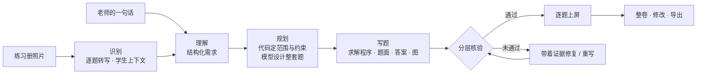

<div align="center">

# VeriChalk

**面向小学数学教师的可验证命题 Agent**

说一句话或拍一页练习册，就能得到答案经过核验、贴合学生进度、能把多个知识点串起来的好题与整份试卷。

[](https://github.com/Scorpioyyy/verichalk/actions/workflows/ci.yml)


[功能](#功能) · [效果](#效果) · [工作原理](#工作原理) · [快速开始](#快速开始) · [文档](#文档)

</div>


## 为什么做 VeriChalk

"双减"之后，现成的练习题不够用，小学数学老师常要自己补题，也越来越多地借助大模型出题。但通用大模型出的题常有答案算错、超出学生所学的问题，也很难把几个知识点自然地串成一道综合题，老师仍要逐题检查修改，难以直接使用（来自安徽霍邱师范附小数学老师的一线反馈）。

VeriChalk 要做的，是让老师拿到就能用的题：**答案对**、**不超纲**，并且**能把学过的知识点组合成有思维含量的综合题**。

## 核心优势

- ✅ **答案经过两路独立核验**：写题时同时写出求解程序并在沙箱里精确计算，另一家厂商的模型在看不到答案的情况下独立解题，两者一致才标"已核验"；不一致就带着证据修复，修不好宁可不给。
- 🎯 **只考学生学过的**：精确到课时的能力边界——学过哪些数、哪些运算、哪些计量单位，超出就退回重写。
- 🧩 **知识点组合得自然**：老师点名的主题优先在本册里找，再沿教材里的前后联系挑出能串成一条解题链的知识点，综合题是"先算这个、再用它求那个"，而不是两道小题拼在一起。
- 🗣️ **听得懂老师的话**："只要计算题""课本那种基础题""情境用做蛋糕"都会照做；说的年级与主题对不上时，会说明并按主题所在的册出题。
- 🖼️ **看图题也能出**：统计图、数轴、钟面、标了尺寸的图形、方格图由结构化规格绘制，图与题、答案始终一致。

## 功能

| | |
|---|---|
| **一句话出题** | "四年级下册小数加减法，出 5 道，有点难度，跟买东西有关"——逐题上屏，每道题带核验状态；需求含糊时只问一个问题 |
| **拍照出题** | 上传 1～4 张练习册 / 作业 / 试卷照片，了解学生学过什么、做过什么，再出新题而不照抄；看不清时先请老师核对 |
| **整份试卷** | 先确认细目表（题型、题量、分值），再看样题，最后成卷；分值合计精确等于满分 |
| **看图题** | 条形 / 折线 / 扇形统计图、数轴、钟面、标了尺寸的图形、方格图，预览与导出同源 |
| **在线修改** | 就地编辑，或一句话修改（"第 3 题换个场景""整体简单一点"）；撤销、版本历史、差异对比，改后自动复核 |
| **导出** | PDF、Word（原生公式）、Markdown、LaTeX；教师版 / 学生版 |
| **调试台** | 每次运行可展开到单次模型调用：流程与时间线、知识点检索、提示与输出、每道题的核验证据 |


## 效果

在一组从未用于调优的出题请求上评测（41 个请求、194 道题，按教材比例覆盖 1～6 年级、四个领域与老师常见的提问方式）。答案对错与是否超纲由**独立审计**判定：两个不同厂商的思考模型各自写程序解题，课程边界用知识库自带的抽取器判定，不使用 VeriChalk 自己的核验结论。

| 指标 | **VeriChalk** | 通用大模型直接出题 |
|---|---|---|
| 答案正确 | **97.8%** | 84.1% |
| 超出学生所学 | **4.9%** | 13.8% |
| 可直接使用（答案对、不超纲、题意清楚、解析成立） | **80.9%** | 69.1% |
| 满足老师的具体要求（题量、知识点、题型、情境、来源） | **85.3%** | 62.4% |
| 两套题并排比较，哪套更适合发给学生 | **28 胜** · 9 平 · 3 负 | |

第一道核验通过的题中位数 22 秒上屏，一次出题全部完成的中位数约 75 秒，每道题成本约 ¥0.02。

**其他环节**：需求理解字段准确率 98%；照片逐题转写（未见过的真实练习册页）90%；一句话修改成功率 92%；导出成功率 100%；提示注入防护 8/8。完整的评测设计、数据与结果见 [eval/specs/](eval/specs/)。

## 工作原理



**规划：代码管约束，模型管设计。** 代码确定范围、题量、档位、难度、题型和课时能力边界，并从知识图谱里给出可用的知识点——老师点名的主题按"本册优先"、沿同一条教学主线收入，搭配的知识点来自教材里真实存在的前后联系。模型读老师的原话，为整套题挑选知识点、设计每道题的解题链与情境；代码再校验：知识点只能来自候选，点名的主题必须覆盖，综合题必须是一条完整的解题链。

**核验：分层进行，诚实标注。**

1. **结构检查**（确定性）：题型、填空与答案是否对应、公式语法、图形能否绘制；
2. **求解程序**：写题时同时写出的 Python 程序在沙箱中以精确算术（`Decimal` / `Fraction`）执行，结果须与答案一致；
3. 以下三项并行：**独立盲解**（另一厂商的模型看不到答案独立解题）、**超纲检查**（抽取题目用到的数、运算、概念、单位，对照课时能力边界做确定性判定）、**题面评审**（歧义、条件完整、数据合理、解析成立、综合题是否真综合）。

求解程序与盲解一致才标"已核验"；任一项不通过，带着失败证据修复，仍不通过就换一种更稳妥的写法补出。

**设计原则**：知识库是上下文而不是模板——教材题告诉模型"学生做过什么"，新题在新情境里生成；能用规则或算法完成的不交给模型；用户看到的进度、调试台与评测读的是同一份事件日志；每个模块都是可关闭的开关，经消融验证有收益才保留。课程知识（北师大版 1～6 年级的知识图谱、题型、课时能力边界与情境）来自独立项目 [ChalkBase](https://github.com/Scorpioyyy/chalkbase)。

## 调试台


每次运行都能展开到单次模型调用：提示分为静态 / 稳定 / 动态三段并标出缓存命中，每道题的核验证据（求解程序与输出、盲解过程、超纲判定）都可查看；发现的问题可以一键入库，按根因归类后回归。

## 快速开始

需要 Python ≥ 3.11、Node ≥ 20，以及阿里云百炼的密钥：

```bash
export VERICHALK_PROFILE=cn            # cn（国内节点）或 intl（新加坡节点）
export DASHSCOPE_API_KEY=...           # intl 用 DASHSCOPE_INTL_API_KEY
export DASHSCOPE_BASE_URL=...          # intl 用 DASHSCOPE_INTL_BASE_URL
```

```bash
pip install -e "backend[dev]"
cd frontend && npm install && npm run build && cd ..
python scripts/dev.py run              # http://localhost:8000 ：用户端 /，调试台 /debug
```

开发与测试：

```bash
python scripts/dev.py check            # ruff + pyright + pytest
cd frontend && npm run check           # tsc + eslint + prettier + vitest
cd frontend && E2E_MODE=replay npx playwright test   # 端到端（回放录制，无需密钥）
```

部署为单容器（前后端同源），见 [deploy/README.md](deploy/README.md)。

## 技术栈

| | |
|---|---|
| 后端 | Python 3.11 · FastAPI · asyncio · Pydantic v2 · SQLite（WAL）· SSE |
| 前端 | React 19 · TypeScript · Vite · KaTeX · pdf.js · d3 |
| 导出 | Typst（PDF 与图形）· pandoc（Word / Markdown / LaTeX） |
| 模型 | 阿里云百炼（DashScope）：写题 qwen3.7-plus；理解、盲解与核验 deepseek-v4.1-flash；照片识别 qwen3.8-flash |
| 知识 | [ChalkBase](https://github.com/Scorpioyyy/chalkbase)：知识图谱、题型、课时能力边界、情境 |
| 质量 | pytest（1000+，含分层依赖与契约检查）· vitest · Playwright 端到端（模型录制回放）· ruff · pyright |

## 项目结构

```
verichalk/
├── backend/src/verichalk/
│   ├── core · domain                  配置、领域模型（前后端契约的来源）
│   ├── llm · trace · store · sandbox  模型网关、事件与 trace、存储、受限执行
│   ├── knowledge · verify · figures · render · perception
│   ├── stages · orchestrator · api    理解 / 识别 / 规划 / 生成 / 编辑 / 导出，编排，HTTP 接口
│   └── prompts · eval                 版本化的提示词，评测框架
├── frontend/src/{user,debug,shared}   用户端、调试台、共享组件（类型由 OpenAPI 生成）
├── eval/                              评测规格、数据集、标注、审计缓存、报告
└── docs/                              需求、指标、架构、设计决策、评测方案、迭代记录
```

## 文档

| 文档 | 内容 |
|---|---|
| [产品需求](docs/prd.md) | 用户、场景、功能与验收标准 |
| [指标体系](docs/metrics.md) | 北极星 / 闸门 / 目标 / 护栏 / 诊断五层指标 |
| [架构](docs/architecture.md) | 分层、数据模型、事件协议、各阶段 |
| [设计决策](docs/design.md) | 每个关键取舍的理由与证据 |
| [评测方案](docs/evaluation.md) | 三层评测、独立审计、判官校准、问题闭环、消融 |
| [迭代记录](docs/history.md) | 各里程碑做了什么、证据与教训 |
| [路线图](docs/roadmap.md) | 里程碑、现状与后续方向 |

## 许可

[MIT](LICENSE)
