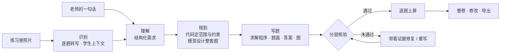

<div align="center">

# VeriChalk

**面向小学数学教师的可验证命题 Agent**

一句话或一张练习册照片说清需求，得到答案经过核验、在学生所学范围内的题目与整份试卷；<br/>
在线修改，一键导出 PDF / Word / Markdown / LaTeX。

[](https://github.com/Scorpioyyy/verichalk/actions/workflows/ci.yml)


</div>


## 为什么做 VeriChalk

一线教师已经在用通用大模型出题，却不敢直接把结果发给学生：

- **答案会算错**，而老师没有时间逐题验算；
- **不知道学生学到哪一课**，四年级下册的题里出现了还没学的小数除法；
- **"它觉得重要的，不是我觉得重要的"**——要的是跨单元综合、贴近生活，拿到的是换了数字的课本题，或者两道无关小题拼成的"综合题"。

VeriChalk 用课程知识库约束"能出什么"，用相互独立的多路核验保证"答案对"，并让每一次改进都由评测证明。课程知识（北师大版 1～6 年级的知识图谱、题型、课时级能力边界与情境）来自独立项目 [ChalkBase](https://github.com/Scorpioyyy/chalkbase)。

## 功能

| | |
|---|---|
| **一句话出题** | "四年级下册小数加减法，出 5 道，有点难度，跟买东西有关"——逐题上屏，每道题带核验状态；需求含糊时只问一个问题 |
| **拍照出题** | 上传 1～4 张练习册 / 作业 / 试卷照片，照片用来了解学生学过什么、做过什么，新题不照抄；看不清时先请老师核对 |
| **整份试卷** | 先确认细目表（题型、题量、分值），再看样题，最后成卷；分值合计精确等于满分 |
| **看图题** | 条形统计图、数轴、标了尺寸的图形、方格图由结构化规格绘制，预览与导出同源 |
| **在线修改** | 就地编辑，或一句话修改（"第 3 题换个场景""整体简单一点"）；撤销、版本历史、差异对比，改后自动复核 |
| **导出** | PDF（Typst 排版）、Word（原生公式）、Markdown、LaTeX；教师版 / 学生版 |
| **调试台** | 每次运行一棵 span 树：阶段与时间线、按学期分层的知识图检索、每次模型调用的提示与输出、题目的核验证据；可就某次运行与 AI 对话分析 |


## 工作原理



**规划：代码管约束，模型管设计。** 代码确定范围、题量、档位、难度、题型和课时能力边界（学过的数域、运算形态、计量单位），并按"本册优先"从知识图谱中给出可用知识点；模型读老师的原话，为整套题挑选知识点、设计每道题的解题链与情境；代码再校验——知识点只能来自候选、点名的主题必须覆盖、综合题必须是一条完整的解题链。

**核验：两路独立求解，诚实标注。** 每道题依次经过：

1. **结构检查**（确定性）：题型、填空位置、公式语法、图形能否绘制；
2. **求解程序**：写题时同时写出的 Python 程序在沙箱中以精确算术（`Decimal` / `Fraction`）执行，结果须与答案一致；
3. 以下三项并行：
   - **独立盲解**：另一厂商的模型在看不到答案的情况下解题；
   - **超纲检查**：抽取题目用到的数、运算、概念、单位，对照目标课时的能力边界做确定性判定；
   - **题面评审**：歧义、条件完整、数据合理、解析成立、综合题是否真综合。

求解程序与盲解一致才标"已核验"；任一项不通过，带着失败证据修复，仍不通过就丢弃重出——宁可少给，不给错题。

**其他设计原则**

- **知识库是上下文，不是模板**：教材题告诉模型"学生做过什么"，新题在新情境里生成，而不是改教材原题的数字。
- **确定性优先**：能用规则或算法完成的不交给模型；模型只用在需要语义理解与生成的地方，业务代码只写角色（理解 / 写题 / 盲解 / 识别），模型由配置决定。
- **一切可观测**：用户看到的进度、调试台、指标与评测读的是同一份事件日志。
- **评测先行，消融验证**：每个模块都是可关闭的开关，没有可度量收益的模块不保留；模型调用可录制回放，回归测试无网络、无密钥、零成本。

## 效果

**出题端到端**：在从未用于调优的留出集上运行一次（36 个出题请求，共要求 185 题），与"同一个模型一次直出、不核验"对比。答案正确与是否超纲由独立审计判定——两个不同厂商的思考模型各自写程序解题、课程边界用知识库自带的抽取器判定，都不使用线上核验的结论。

| 指标 | VeriChalk | 直接用大模型 |
|---|---|---|
| 交付题答案正确 | **96.6%** | 83.8% |
| 标"已核验"的题答案正确 | **97.3%** | — |
| 超出所学范围 | **9.4%** | 11.6% |
| 交付题可直接使用（答案对、不超纲、题意清楚、解析成立） | **82.9%** | 69.9% |
| 综合题确实用到了所有声称的知识点 | 18 / 18 | — |
| 题量达成率（交付 / 要求） | 67.0% | 98.9% |
| 首题上屏 / 全部完成（中位数） | 21 秒 / 73 秒 | — / 10 秒 |
| 每题成本 | ¥0.037 | ¥0.001 |

核验换来的是可以放心发给学生的题：审计确认答错的题，直接用大模型是 173 道里 18 道，VeriChalk 是 117 道里 1 道。代价是更慢、更贵，而且宁可少给也不给错题——对只能靠看图出题的主题、或超出所选年级的请求，交付不足（见[后续方向](#后续方向)）。完整报告与分析见 [eval/specs/produce.md §8](eval/specs/produce.md)。

**各环节**（各自的测试集，详见 [eval/specs/](eval/specs/)）：需求理解字段准确率 0.98；照片逐题转写（未见过的真实练习册页）0.90；自然语言修改成功率 0.92；导出成功率 1.00；提示注入防护 8/8。

## 调试台


每次运行都能展开到单次模型调用：提示分为静态 / 稳定 / 动态三段并标出缓存命中，题目的每一项核验证据（求解程序与输出、盲解过程、超纲判定）都可查看；发现的坏例子可以一键入库，按根因归类后回归。

## 技术栈

| | |
|---|---|
| 后端 | Python 3.11 · FastAPI · asyncio · Pydantic v2 · SQLite（WAL）· SSE |
| 前端 | React 19 · TypeScript · Vite · KaTeX · pdf.js · d3 |
| 导出 | Typst（PDF 与图形）· pandoc（Word / Markdown / LaTeX） |
| 模型 | 阿里云百炼（DashScope）：写题 qwen3.7-plus；理解、盲解与核验 deepseek-v4.1-flash；照片识别 qwen3.8-flash |
| 知识 | [ChalkBase](https://github.com/Scorpioyyy/chalkbase)：知识图谱、题型、课时能力边界、情境 |
| 质量 | pytest（1000+，含分层依赖与契约检查）· vitest · Playwright 端到端（模型录制回放）· ruff · pyright |

## 快速开始

需要 Python ≥ 3.11、Node ≥ 20，以及阿里云百炼的密钥：

```bash
export VERICHALK_PROFILE=cn            # cn（国内节点）或 intl（新加坡节点）
export DASHSCOPE_API_KEY=...           # intl 用 DASHSCOPE_INTL_API_KEY
export DASHSCOPE_BASE_URL=...          # intl 用 DASHSCOPE_INTL_BASE_URL
```

```bash
pip install -e "backend[dev]"
cd frontend && npm install && npm run build && cd ..
python scripts/dev.py run              # http://localhost:8000 ：用户端 /，调试台 /debug
```

开发与测试：

```bash
python scripts/dev.py check            # ruff + pyright + pytest
cd frontend && npm run check           # tsc + eslint + prettier + vitest
cd frontend && E2E_MODE=replay npx playwright test   # 端到端（回放录制，无需密钥）
```

部署为单容器（前后端同源），见 [deploy/README.md](deploy/README.md)。

## 项目结构

```
verichalk/
├── backend/src/verichalk/
│   ├── core · domain                  配置、领域模型（前后端契约的来源）
│   ├── llm · trace · store · sandbox  模型网关、事件与 trace、存储、受限执行
│   ├── knowledge · verify · figures · render · perception
│   ├── stages · orchestrator · api    理解 / 识别 / 规划 / 生成 / 编辑 / 导出，编排，HTTP 接口
│   └── prompts · eval                 版本化的提示词，评测框架
├── frontend/src/{user,debug,shared}   用户端、调试台、共享组件（类型由 OpenAPI 生成）
├── eval/                              评测规格、数据集、标注、审计缓存、报告
└── docs/                              需求、指标、架构、设计决策、评测方案、迭代记录
```

## 文档

| 文档 | 内容 |
|---|---|
| [产品需求](docs/prd.md) | 用户、场景、功能与验收标准 |
| [指标体系](docs/metrics.md) | 北极星 / 闸门 / 目标 / 护栏 / 诊断五层指标 |
| [架构](docs/architecture.md) | 分层、数据模型、事件协议、各阶段 |
| [设计决策](docs/design.md) | 每个关键取舍的理由与证据（D1…D61） |
| [评测方案](docs/evaluation.md) | 三层评测、独立审计、判官校准、badcase 闭环、消融 |
| [迭代记录](docs/history.md) | 各里程碑做了什么、证据与教训 |
| [评测规格与结果](eval/specs/) | 各阶段的失败模式、数据、阈值与结果 |

## 后续方向

- **需求贴合**：老师点名的主题只能靠看图出题、或超出所选年级时，先说明并给出选项，而不是换成别的内容；"只要计算题""课本那种基础题"这类形式要求由代码约束；
- 支持组合图形与立体图形；
- 调试台支持从任一阶段重放、对比两次运行。

## 许可

[MIT](LICENSE)
